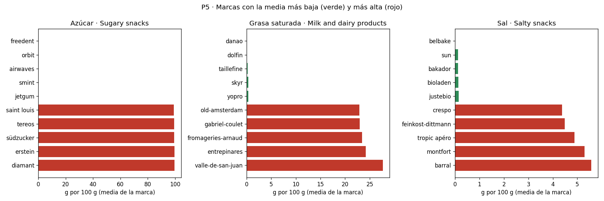
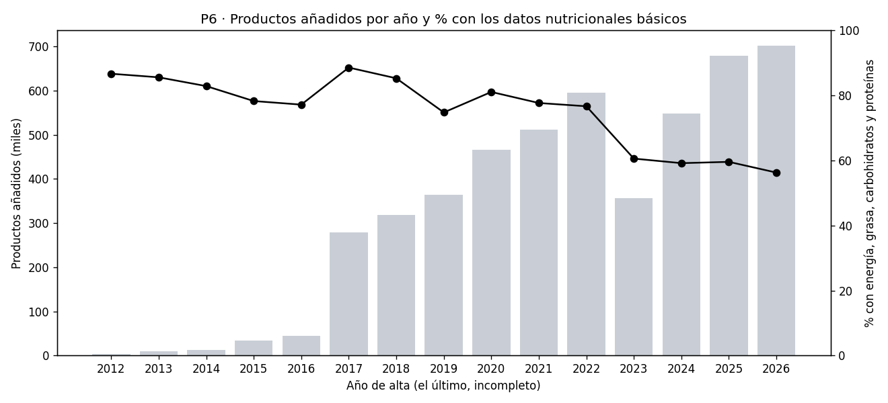
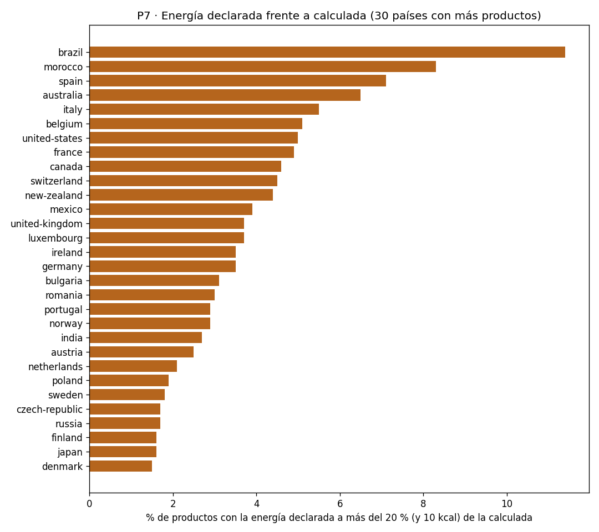
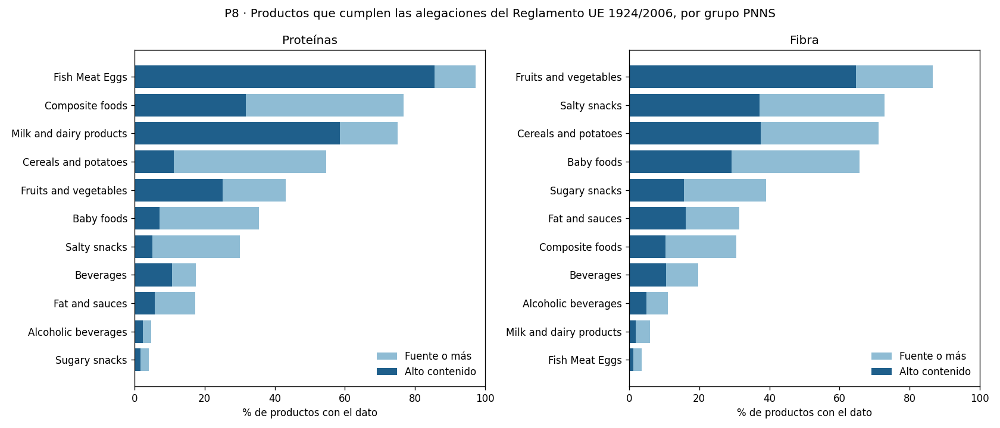

# Open Food Facts analytics

**Jorge Andrés Vargas Cordoba** · MUCSI, Universidad de Deusto (2026-27) · Big Data

Cuatro preguntas con Spark sobre el CSV de Open Food Facts (≈ 4,9 M productos, 13 GB), en un clúster Hadoop en AWS Academy: Ansible de clase + nuestros scripts.

## Arquitectura

| Nodo | Procesos | Qué hace |
|---|---|---|
| `hadoop-master` | NameNode, ResourceManager | Coordina HDFS y YARN. No ejecuta trabajos |
| `hadoop-worker-1/2/3` | DataNode, NodeManager | Guardan los bloques (3 réplicas) y ejecutan los executors (6 GB cada uno) |
| `hadoop-client-ingest` | driver de Spark | Sube el CSV y lanza la limpieza. Usuario de HDFS `ingest` |
| `hadoop-client-query` | driver de Spark | Lanza las preguntas. Usuario de HDFS `query` |

| Ruta en HDFS | Dueño | Contenido |
|---|---|---|
| `/data/raw` | ingest | `openfoodfacts.csv` y `sample.csv` (2 %) |
| `/data/clean/products` | ingest | Parquet limpio |
| `/results/qNN-…` | query | Un CSV por pregunta |

- `query` lee `/data` pero no puede escribir en ella (permisos 755): separación de funciones, no seguridad real (sin Kerberos).
- No lanzar trabajos de los dos clientes a la vez: comparten los 18 GB de YARN.

## Archivos

```
up.sh                        levantar el clúster: llama uno a uno a los pasos de cluster/
stop.sh / down.sh            apagar / borrar las 6 instancias
nodes.sh / tunnels.sh        SSH de cada nodo / webs de HDFS y YARN en localhost
push.sh / pull.sh            código a los clientes / resultados de HDFS a results/
plot-results.py              gráficas de results/*.csv (no necesita el clúster)
cluster/01-prepare.sh        clave, credenciales y Ansible de clase
cluster/02-master-workers.sh master y 3 workers con HDFS y YARN (Ansible)
cluster/03-clients.sh        crear los clientes ingest y query
cluster/04-start.sh          encender lo apagado y esperar a las 6 instancias
cluster/05-ssh.sh            el master entra a todos por nombre; /etc/hosts
cluster/06-yarn-workers.sh   YARN de los workers (worker-yarn-site.xml): 6 GB y 2 vCores
cluster/07-hdfs-folders.sh   carpetas de HDFS y sus dueños
cluster/08-install-clients.sh Java, Hadoop y Spark en los clientes; usuario de HDFS
cluster/09-check.sh          SparkPi desde los clientes y estado del clúster
cluster/common.sh            clave, SSH, nodos y atajos (on_master, on_client)
cluster/versions.sh          versiones de Hadoop y Spark (el único sitio donde cambiarlas)
ingest/clean-products.py     cliente ingest: CSV → Parquet limpio
query/q05…q08-*.py           cliente query: una pregunta por archivo
results/                     un CSV y una gráfica por pregunta
```

Todos los `.sh` se ejecutan en tu equipo; los pasos que actúan en el master o en un cliente entran por SSH.

## Uso

Paso a paso con capturas de una ejecución completa: [docs/step-by-step.md](docs/step-by-step.md).

**Una vez:** WSL con `sudo apt install -y git python3-venv libffi-dev unzip python3-pandas python3-matplotlib`, [AWS CLI](https://docs.aws.amazon.com/cli/latest/userguide/getting-started-install.html) y `cp ~/Downloads/labsuser.pem ~/.ssh/vockey.pem && chmod 600 ~/.ssh/vockey.pem`. **En cada sesión:** credenciales del Learner Lab en `~/.aws/credentials`.

```bash
./up.sh                 # clúster listo (~30 min la primera vez), con nodos y webs
```

Cliente ingest (SSH de `./nodes.sh`):

```bash
curl -sL https://static.openfoodfacts.org/data/en.openfoodfacts.org.products.csv.gz \
  | gunzip | hdfs dfs -put -f - /data/raw/openfoodfacts.csv
hdfs dfs -cat /data/raw/openfoodfacts.csv | awk 'NR == 1 || rand() < 0.02' | hdfs dfs -put -f - /data/raw/sample.csv
cd open-food-facts-analytics
spark-submit ingest/clean-products.py hdfs:///data/raw/sample.csv   # prueba
nohup spark-submit ingest/clean-products.py > clean.out 2>&1 &      # completo
```

Cliente query, después de la limpieza:

```bash
cd open-food-facts-analytics
spark-submit query/q05-brands-by-pnns-group.py   # igual con q06, q07, q08
```

Tu equipo:

```bash
./pull.sh && python3 plot-results.py   # results/*.csv y *.png
./stop.sh                              # apagar (HDFS conserva los datos); ./down.sh borra
```

## Resultados

| # | Pregunta | Técnica Spark |
|---|---|---|
| 5 | Las 5 marcas con la media más baja y más alta de azúcar, grasa saturada y sal, por grupo PNNS | `explode` + `groupBy` + `Window` (`row_number`) |
| 6 | Productos añadidos por año y % con energía y macronutrientes | `groupBy` + `Window` (`lag`) |
| 7 | % de productos con la energía declarada a más del 20 % de la calculada (4·carb. + 4·prot. + 9·grasa), por país | columna calculada + `explode` + `groupBy` |
| 8 | % que cumple «fuente de» y «alto contenido de» proteínas y fibra (Reglamento UE 1924/2006), por grupo PNNS | `when` por umbral + `groupBy` |

**P5.** En dulces, las marcas de chicle sin azúcar frente a las de azúcar puro (≈ 99 g/100 g).



**P6.** El catálogo crece cada año (701 mil altas en 2026), pero el % con los cuatro datos básicos baja del ≈ 87 % al ≈ 56 %.



**P7.** En la mayoría de países, entre el 1 % y el 5 % de los productos declaran una energía incoherente; Brasil llega al 11,4 %.



**P8.** El 97 % de carnes, pescados y huevos es fuente de proteína; el 87 % de frutas y verduras, fuente de fibra.



| Job | Usuario | Duración |
|---|---|---|
| Limpieza (muestra / completa, 13 GB) | `ingest` | 50 s / 2 min 31 s |
| q05 · q06 · q07 · q08 | `query` | 48 s · 38 s · 42 s · 40 s |

Las preguntas leen ~119 MB de Parquet: buena parte de esos ~40 s es el arranque de Spark en YARN.

## Comandos útiles

`hdfs` y `yarn` funcionan desde los clientes con su usuario; la administración de HDFS, desde el master (`ec2-user`, superusuario).

| Para… | Comando | Dónde |
|---|---|---|
| Comprobar el clúster | `bash cluster/09-check.sh` | tu equipo |
| Ver carpetas y tamaños | `hdfs dfs -ls -h /data` · `hdfs dfs -du -s -h /data/clean/products` | cliente |
| Estado de HDFS / bloques | `hdfs dfsadmin -report \| head -20` · `hdfs fsck /data \| tail` | master |
| Nodos de YARN | `yarn node -list` | cliente o master |
| Jobs | `yarn application -list -appStates ALL` | cliente o master |
| Logs de los executors | `yarn logs -applicationId <id> \| less` | cliente que lanzó el job |
| Matar un job | `yarn application -kill <id>` | cliente que lanzó el job |
| Progreso real de un job | `ssh -i ~/.ssh/vockey.pem -N -L 4040:localhost:4040 ec2-user@<cliente>` → `localhost:4040` | tu equipo |
| Procesos Java | `jps` | cada nodo |
| Reiniciar un servicio | `sudo systemctl restart nodemanager` (o `datanode`, `namenode`, `resourcemanager`) | el nodo |
