# Open Food Facts analytics

Preguntas analíticas con Spark sobre el CSV de Open Food Facts, en un clúster Hadoop en AWS Academy (Ansible de clase + nuestros scripts).

## Requisitos

- Windows: **WSL** (Ubuntu). Mac: **Terminal**.
- `git` y `python3` (en Mac vienen con `xcode-select --install`).
- Learner Lab arrancado y `labsuser.pem` descargado (AWS Details, Download PEM).
- Scripts ejecutables. Si al lanzar uno sale `Permission denied`: `chmod +x cluster/*.sh tests/*.sh run.sh`.

Las capturas van en `docs/assets/` con el nombre que indica cada paso.

---

## Crear todo desde cero

### 0. Preparar tu equipo (una vez)

En tu equipo:

Dependencias (en Mac no hace falta: git y python3 vienen con `xcode-select --install`):

```bash
sudo apt update
sudo apt install -y git python3-venv libffi-dev
```

Copiar la clave donde la espera el playbook (Learner Lab la da como `labsuser.pem`):

```bash
mkdir -p ~/.ssh
cp ~/Downloads/labsuser.pem ~/.ssh/vockey.pem
chmod og-rwx ~/.ssh/vockey.pem
```

Instalar Ansible, AWS CLI y clonar el playbook:

```bash
./cluster/00-prepare-local.sh
```

> [!WARNING]
> Pegar las credenciales de AWS (Learner Lab, AWS Details, AWS CLI, Show).
> Caducan con cada sesión del lab: repetir este bloque cada vez que arranques el Learner Lab.

```bash
mkdir -p ~/.aws
nano ~/.aws/credentials        # pegar, guardar con Ctrl+O y Enter, salir con Ctrl+X
```

Comprobar que AWS responde sin error:

```bash
source ~/ansible/bin/activate
aws ec2 describe-instances --region us-east-1
```

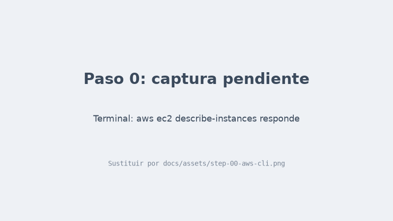

### 1. Crear master y 3 workers con Ansible (~10 min)

En tu equipo:

```bash
./cluster/01-create-cluster.sh
```

Comprobar en AWS:

- EC2, Instances: `hadoop-master`, `hadoop-worker-1`, `hadoop-worker-2`, `hadoop-worker-3` en `Running`.
- EC2, Security Groups: `hadoop-sg` y `hadoop-master-sg`.

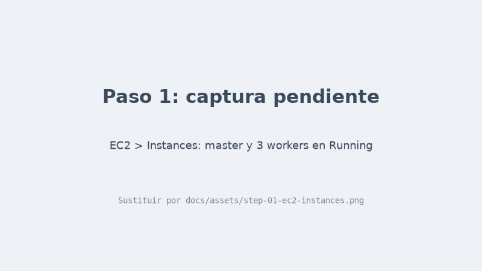

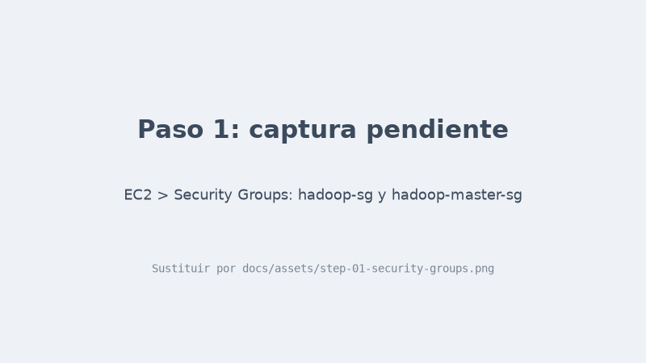

### 2. Abrir el SSH a cualquier IP

En tu equipo:

```bash
./cluster/02-open-ssh.sh
```

Comprobar en AWS: EC2, Security Groups, `hadoop-master-sg`, Inbound rules: SSH, puerto 22, origen `0.0.0.0/0`.

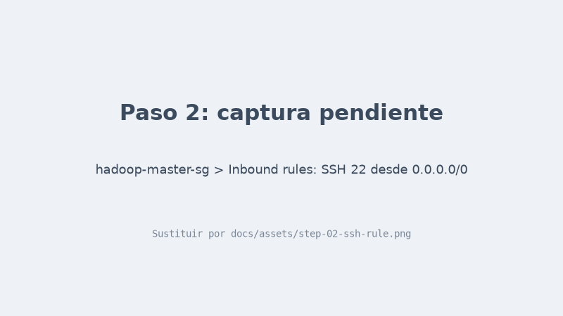

### 3. Crear el client

En tu equipo:

```bash
./cluster/03-create-client.sh
```

Comprobar en AWS: EC2, Instances: `hadoop-client` en `Running` con `2/2 checks passed`.

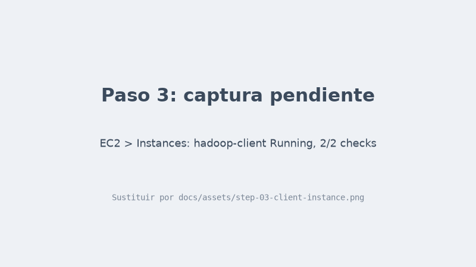

### 4. Copiar el proyecto al master

En tu equipo:

```bash
./cluster/04-copy-to-master.sh
```

Al final muestra el comando para entrar al master. Entrar y ir al proyecto:

```bash
ssh -i ~/.ssh/vockey.pem ec2-user@<DNS-DEL-MASTER>
cd open-food-facts-analytics
```

Comprobar en la terminal: `ls` muestra `cluster`, `jobs`, `run.sh`...

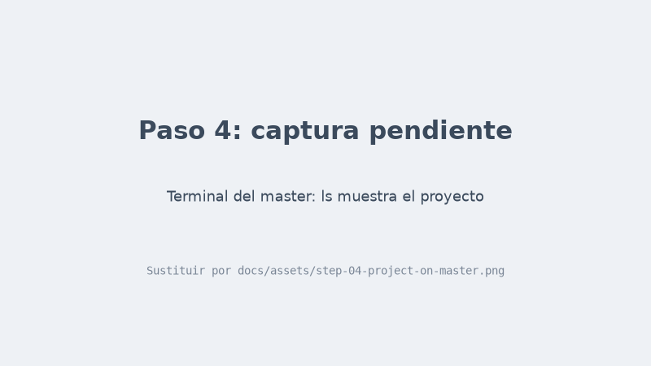

### 5. SSH entre nodos y /etc/hosts

En el master:

```bash
./cluster/05-setup-master.sh
```

Comprobar en la terminal: 4 líneas `hadoop-worker-1: ip-172-...` (una por nodo).


### 6. Configuración de YARN (6 GB por worker)

En el master:

```bash
./cluster/06-apply-config.sh
```

Comprobar en la web de YARN. En otra terminal de tu equipo abrir el túnel y dejarla abierta:

```bash
ssh -i ~/.ssh/vockey.pem -N -L 8088:<DNS-DEL-MASTER>:8088 ec2-user@<DNS-DEL-MASTER>
```

Abrir http://localhost:8088/cluster/nodes: 3 nodos `RUNNING`, cada uno con `6 GB` de memoria. En http://localhost:8088/cluster, Total Resources `<memory:18 GB, vCores:6>`.

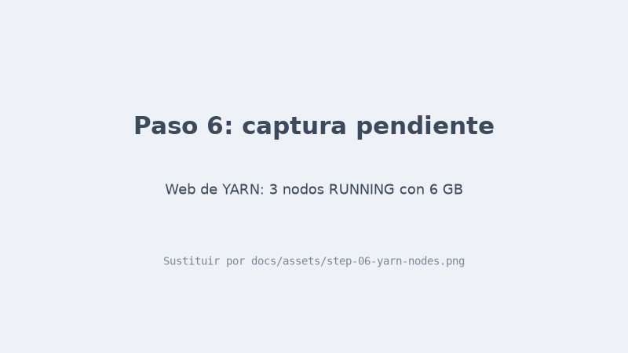

### 7. Spark en el client

En el master:

```bash
./cluster/07-setup-client.sh
```

Comprobar en la terminal: `Pi is roughly 3.14`. En la web de YARN (http://localhost:8088/cluster/apps): la aplicación `PythonPi` en `FINISHED`.

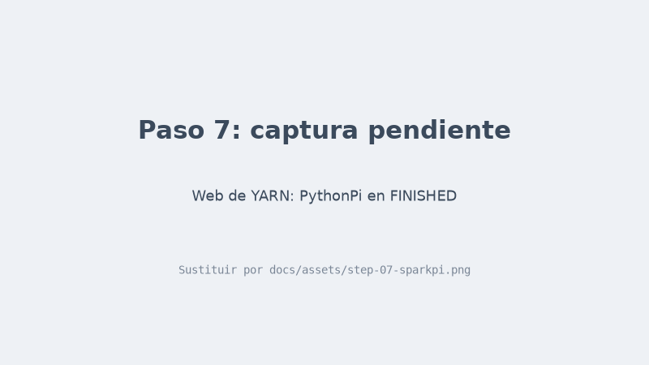

### 8. Subir el CSV a HDFS (~15 min)

En el master:

```bash
nohup ./cluster/08-upload-data.sh > upload.log 2>&1 &
tail -f upload.log            # Ctrl+C deja de mirar, el script sigue
```

Comprobar en la web de HDFS. En otra terminal de tu equipo:

```bash
ssh -i ~/.ssh/vockey.pem -N -L 50070:<DNS-DEL-MASTER>:50070 ec2-user@<DNS-DEL-MASTER>
```

Abrir http://localhost:50070, Utilities, Browse the file system, `/data/raw`: `openfoodfacts.csv` (~13 GB) y `muestra.csv`.

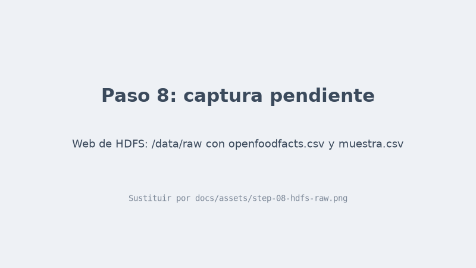

### 9. Limpiar los datos

Entrar al client desde el master:

```bash
ssh hadoop-client
cd open-food-facts-analytics
```

En el client, primero con la muestra y después con el CSV completo:

```bash
./run.sh jobs/00-etl.py hdfs:///data/raw/muestra.csv
./run.sh jobs/00-etl.py
```

Comprobar en la terminal: `Filas del CSV` (~4,88 millones con el completo) y la tabla de cuántos productos tienen cada dato. En la web de HDFS: carpeta `/data/clean/products`.

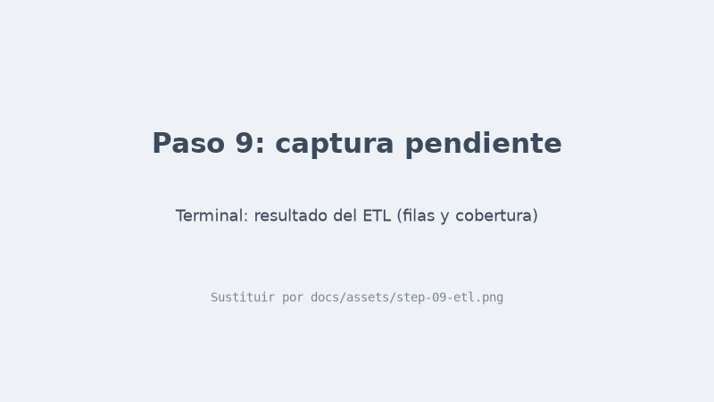

### 10. Las preguntas

En el client:

```bash
for f in jobs/q*.py; do ./run.sh "$f"; done
```

Comprobar en la terminal: un `OK qNN-...` por pregunta. En la web de HDFS: una carpeta por pregunta en `/results`.

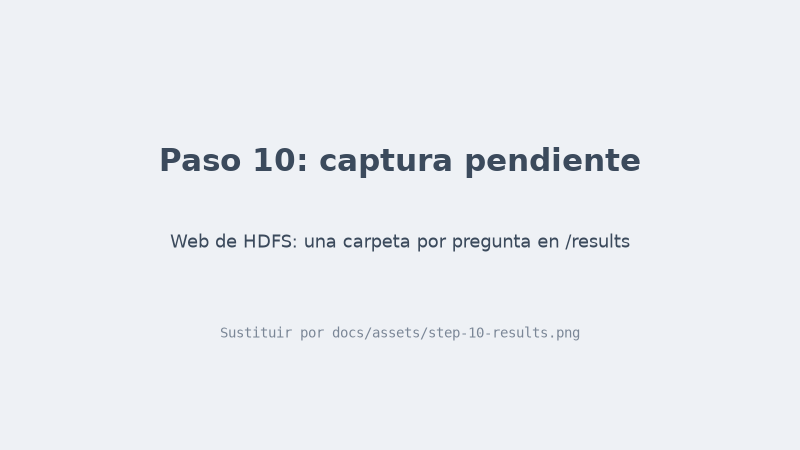

---

## Cada sesión

```bash
./cluster/start.sh          # tu equipo: encender (muestra el DNS del master, cambia cada vez)
./cluster/check-cluster.sh  # master: comprobar que todo está arrancado
./cluster/stop.sh           # tu equipo: apagar al terminar
```

## Probar en local, sin AWS

```bash
./tests/setup-local-test.sh   # una vez: Java + PySpark
./tests/local-test.sh         # ETL + preguntas + gráficas con tests/sample-1k.csv
```

## Borrar todo al final

```bash
./cluster/99-delete-cluster.sh
```
