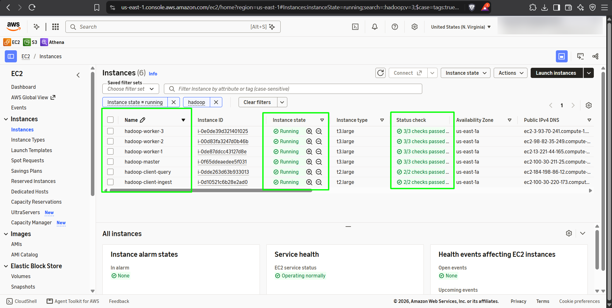
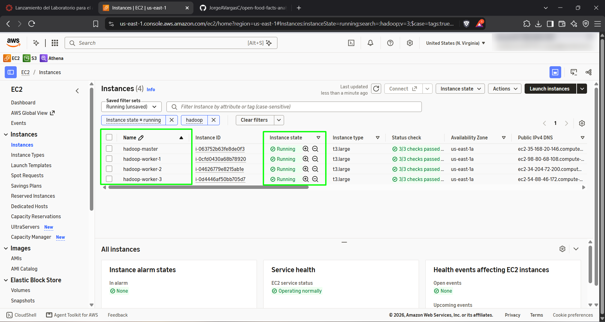
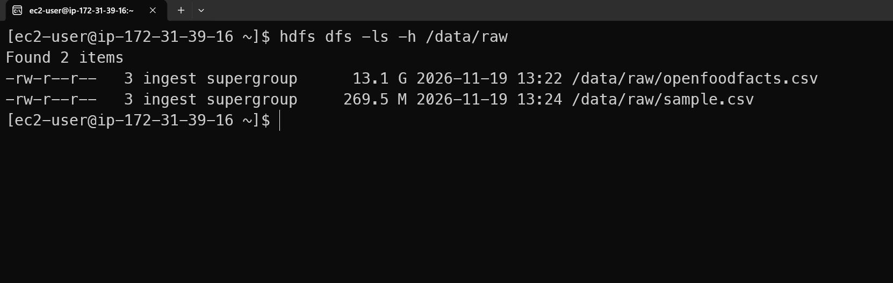
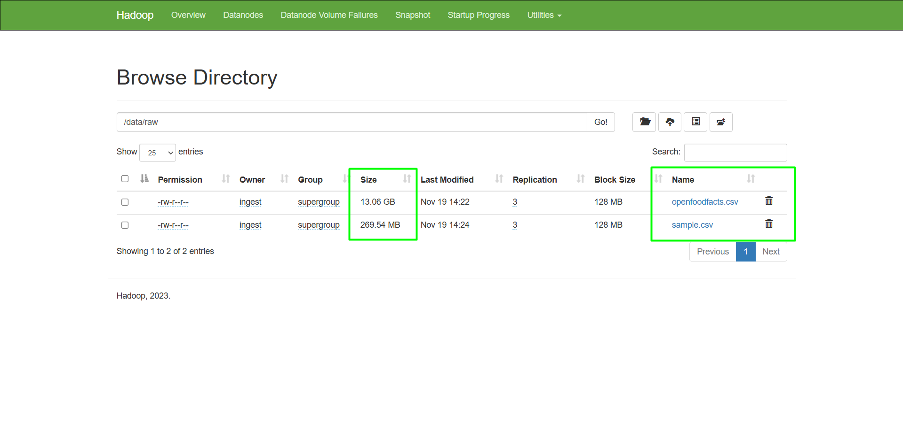
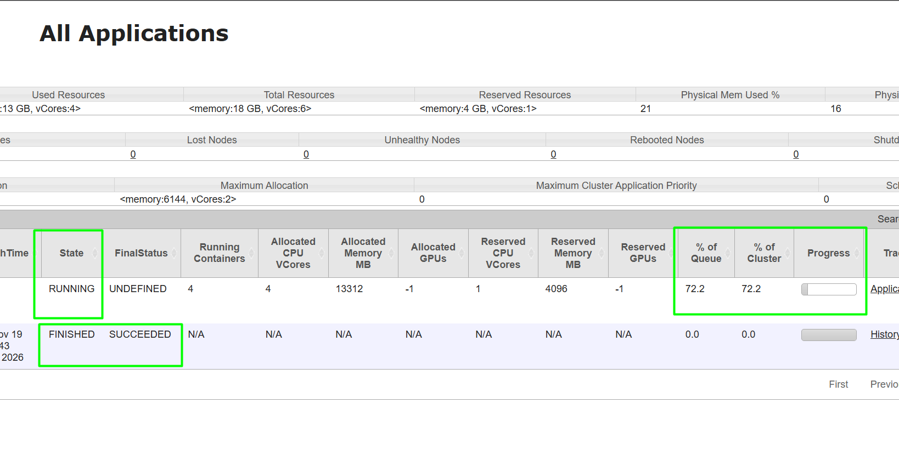

# Open Food Facts analytics

**Jorge Andrés Vargas Cordoba** · MUCSI, Universidad de Deusto (2026-27) · Big Data

Preguntas analíticas con Spark sobre el CSV de Open Food Facts (≈ 4,9 M productos, 13 GB), en un clúster Hadoop en AWS Academy (Ansible de clase + nuestros scripts).

## Arquitectura

| Nodo | Procesos | Qué hace |
|---|---|---|
| `hadoop-master` | NameNode, ResourceManager | Coordina HDFS y YARN. No ejecuta trabajos |
| `hadoop-worker-1/2/3` | DataNode, NodeManager | Guardan los bloques (3 réplicas) y ejecutan los executors de Spark (6 GB cada uno) |
| `hadoop-client-ingest` | driver de Spark | Sube el CSV a HDFS y lanza la limpieza. Usuario de HDFS `ingest` |
| `hadoop-client-query` | driver de Spark | Lanza las preguntas y dibuja las gráficas. Usuario de HDFS `query` |

| Ruta en HDFS | Dueño | Contenido |
|---|---|---|
| `/data/raw` | ingest | `openfoodfacts.csv` y `sample.csv` (2 %) |
| `/data/clean/products` | ingest | Parquet limpio |
| `/results/qNN-…` | query | Un CSV por pregunta |

`query` puede leer `/data` pero no escribir en ella (permisos 755). No lanzar a la vez trabajos de los dos clientes: comparten los 18 GB de YARN.

## Archivos

```
up.sh                 tu equipo: levanta el clúster (crea, enciende y configura)
sync.sh               tu equipo: copia ingest/ o query/ a cada cliente
down.sh               tu equipo: borra todo (o --stop para solo apagar)
nodes.sh              tu equipo: lista los nodos y el SSH de cada uno
tunnels.sh            tu equipo: abre las webs de HDFS y YARN en localhost (stop para cerrarlas)
cluster/master.sh     master: setup (SSH, /etc/hosts, YARN, carpetas de HDFS, clientes) | check
cluster/client.sh     cliente: instala Java, Hadoop y Spark y fija su usuario de HDFS
cluster/worker-yarn-site.xml   YARN de los workers: 6 GB por nodo
ingest/clean.py       cliente ingest: CSV → Parquet limpio
query/q05…q08.py      cliente query: una pregunta por archivo
query/plots.py        cliente query: gráficas de las preguntas
```

## Preparar tu equipo

- Windows: **WSL** (Ubuntu) con `sudo apt install -y git python3-venv libffi-dev unzip` y [AWS CLI](https://docs.aws.amazon.com/cli/latest/userguide/getting-started-install.html).
- Una vez: `mkdir -p ~/.ssh ~/.aws && cp ~/Downloads/labsuser.pem ~/.ssh/vockey.pem && chmod 600 ~/.ssh/vockey.pem` (el PEM sale de AWS Details, Download PEM).
- En cada sesión: Learner Lab, **Start Lab**, AWS Details, AWS CLI, **Show**, y pegarlo en `~/.aws/credentials` (cambia cada vez).

  
  
  

- Si un script da `Permission denied`: `chmod +x *.sh cluster/*.sh ingest/*.sh`.

## Levantar y apagar

```bash
./up.sh              # la primera vez ~1 h; después, unos minutos
./down.sh --stop     # al acabar la sesión: apaga, HDFS conserva los datos
./down.sh            # al acabar el trabajo: borra las 6 instancias
```

`up.sh` se puede relanzar: crea lo que falta, enciende lo apagado y se salta lo hecho. Hace, en orden:

1. Ansible de clase (`memaldi/hadoop-ansible-ec2`): master y 3 workers con HDFS y YARN. Solo si no hay master (formatea HDFS).
2. Los dos clientes, con la misma AMI que el master.
3. `cluster/master.sh setup` en el master. Termina con dos SparkPi (uno por cliente) y el `check`.

Al final lista los nodos con su `ssh`. Lo demás se hace a mano, entrando a cada cliente (secciones siguientes).

Al terminar, en EC2 hay las 6 instancias `running` con los status checks en verde (master y workers `t3.large`, clientes `t2.large`):



Si va bien, tras `== 2. Master y workers` salen las tareas de Ansible (15–40 min). No interrumpirlo:


Cuando Ansible termina, en EC2 hay 4 instancias `running` (master y 3 workers) con los 3 *status checks* en verde:



> [!NOTE]
> La primera vez, Ansible tarda ≈ 15-20 min, casi todo en `Download Hadoop` (archive.apache.org limita la velocidad). Es una sola vez: con `./down.sh --stop` y `./up.sh` los nodos se reutilizan y no se descarga nada. No interrumpas Ansible a mitad.

## Conectarse y ver las webs

```bash
./nodes.sh           # nodos encendidos, su IP privada y el comando SSH de cada uno
./tunnels.sh         # HDFS y YARN en http://localhost:<puerto> (./tunnels.sh stop los cierra)
```

- El DNS del master cambia en cada arranque: `nodes.sh` siempre da el actual.
- Los workers no tienen SSH desde fuera: se entra desde el master (`ssh hadoop-worker-1`).
- Los clientes se pueden abrir directo con el comando de `nodes.sh`, o desde el master con `ssh hadoop-client-ingest` / `ssh hadoop-client-query`.

## Código y datos (a mano)

```bash
./sync.sh            # copia ingest/ o query/ a cada cliente; repítelo cada vez que cambies código
```

Cliente `ingest` (comando de `./nodes.sh`): descargar el CSV a HDFS y crear la muestra.

```bash
# 1. Descargar y subir directo a HDFS, sin pasar por el disco (~15 min)
curl -sL https://static.openfoodfacts.org/data/en.openfoodfacts.org.products.csv.gz \
  | gunzip | hdfs dfs -put -f - /data/raw/openfoodfacts.csv

# 2. Muestra al azar del 2 %, para probar la limpieza
hdfs dfs -cat /data/raw/openfoodfacts.csv \
  | awk 'NR == 1 || rand() < 0.02' | hdfs dfs -put -f - /data/raw/sample.csv

# 3. Comprobar: ~13 G y ~270 M, dueño ingest
hdfs dfs -ls -h /data/raw
```



También se ve en la web de HDFS (`./tunnels.sh` → Utilities → Browse the file system → `/data/raw`): 13 GB y 270 MB, dueño `ingest`, replicación 3, bloques de 128 MB.



El `-` de `put -f - <ruta>` lee de la entrada estándar: así `curl` y `gunzip` encadenados con `|` llegan a HDFS sin ocupar disco en el cliente. Si se ejecuta desde `query`, HDFS responde `Permission denied` (`/data` es de `ingest`).

## Limpieza (cliente ingest)

Entrar con el comando de `./nodes.sh` (`hadoop-client-ingest`).

```bash
cd open-food-facts-analytics
spark-submit ingest/clean.py hdfs:///data/raw/sample.csv   # prueba con la muestra (~1 min)
```

Con la muestra sale `OK` y deja un Parquet pequeño (~3 MB). Después, el CSV completo (13 GB). En segundo plano, para que un corte de SSH no lo mate:

```bash
nohup spark-submit ingest/clean.py > clean.out 2>&1 &
tail -f clean.out                  # Ctrl+C solo deja de mirar; el job sigue
yarn application -list             # otra terminal: el job RUNNING (o la web de YARN con ./tunnels.sh)
hdfs dfs -du -h /data/clean/products   # al acabar: tamaño del Parquet
```

En la web de YARN (`http://localhost:8088/cluster/apps`) el job aparece `RUNNING` y la corrida de la muestra, `FINISHED` / `SUCCEEDED`:



Los 13 312 MB asignados son 3 executors de 4 096 MB (3 GB de memoria + 512 MB de *overhead*, que YARN redondea a 4 GB) más 1 024 MB del *application master*. Eso es el 72 % de los 18 GB del clúster: por eso no cabe un segundo job a la vez.

Imprime las filas leídas, los productos limpios, los incoherentes y cuántos productos tienen cada dato. Sobrescribe `/data/clean/products` (`mode("overwrite")`): hasta que acabe, ahí está la versión de la muestra. No lanzar consultas mientras corre: los 18 GB de YARN no alcanzan para las dos cosas.

## Preguntas (cliente query)

Entrar con el comando de `./nodes.sh` (`hadoop-client-query`). Solo después de que acabe la limpieza completa.

**Una pregunta, paso a paso (la 5):**

```bash
cd open-food-facts-analytics
spark-submit query/q05-brands-by-pnns-group.py
```

`spark-submit` toma la configuración de `spark-defaults.conf` (YARN, 3 executors), lee el Parquet de `/data/clean/products`, imprime el conteo de productos y escribe el resultado como un CSV en HDFS. Para comprobarlo:

```bash
hdfs dfs -ls /results/q05-brands-by-pnns-group                      # _SUCCESS y un part-*.csv
hdfs dfs -cat /results/q05-brands-by-pnns-group/part-*.csv | head   # las primeras filas
```

**Las otras tres son lo mismo, cambiando el archivo** (y la carpeta de resultados):

```bash
spark-submit query/q06-yearly-data-quality.py
spark-submit query/q07-energy-coherence-by-country.py
spark-submit query/q08-protein-fiber-claims.py
```

Una a una, o las cuatro seguidas: `for f in query/q0*.py; do spark-submit "$f"; done`. Después, las gráficas:

```bash
hdfs dfs -get -f /results ./results && python3 query/plots.py   # PNG en figures/
```

| # | Pregunta | Técnica Spark |
|---|---|---|
| 5 | Las 5 marcas con la media más baja y más alta de azúcar, grasa saturada y sal, en cada grupo PNNS | `explode` + `groupBy` + `Window` con `row_number` |
| 6 | Productos añadidos por año, % con energía y macronutrientes y crecimiento anual | `groupBy` + `Window` con `lag` |
| 7 | % de productos con la energía declarada a más del 20 % de la calculada (4·carb. + 4·prot. + 9·grasa), por país | columna calculada + `explode` + `groupBy` |
| 8 | % que cumple «fuente de» y «alto contenido de» proteínas y fibra (Reglamento UE 1924/2006), por grupo PNNS | `when` por umbral + `groupBy` |

## Comprobar el clúster

En el master: `./open-food-facts-analytics/cluster/master.sh check` → procesos de cada nodo, `Live datanodes (3)`, `Total Nodes:3`, dueños de `/data` y `/results` y `Permission denied` cuando `query` intenta escribir en `/data`.

Logs: el driver imprime sus errores en la terminal del cliente; los de los executors, `yarn logs -applicationId <id>`.

## Comandos útiles

Los clientes tienen Hadoop y la configuración del clúster, así que `hdfs` y `yarn` funcionan desde ahí con tu usuario (`ingest` o `query`). El master es el superusuario de HDFS (`ec2-user`): allí van los comandos de administración.

| Para… | Comando | Dónde |
|---|---|---|
| Ver carpetas y tamaños | `hdfs dfs -ls /data` · `hdfs dfs -du -h /data` · `hdfs dfs -df -h` | cliente o master |
| Mirar un resultado | `hdfs dfs -cat /results/q05-*/part-*.csv \| head` | cliente |
| Bajar un resultado a un archivo | `hdfs dfs -getmerge /results/q05-* q05.csv` | cliente |
| Borrar | `hdfs dfs -rm -r /results/q05-*` | cliente `query` (su carpeta `/results`); `/data`, cliente `ingest` |
| Estado de HDFS | `hdfs dfsadmin -report \| head -20` (`Live datanodes (3)`) | master |
| Salud de los bloques | `hdfs fsck /data \| tail -15` | master |
| Nodos de YARN | `yarn node -list` | cliente o master |
| Jobs en ejecución / todos | `yarn application -list` · `yarn application -list -appStates ALL` | cliente o master |
| Progreso real de un job | `ssh -i ~/.ssh/vockey.pem -N -L 4040:localhost:4040 ec2-user@<DNS del cliente que lo lanzó>` → `http://localhost:4040` (el 10 % de YARN es fijo en modo client) | tu equipo (WSL) |
| Logs de un job (executors) | `yarn logs -applicationId <id> \| less` | cliente del usuario que lanzó el job |
| Matar un job | `yarn application -kill <id>` | cliente del usuario que lo lanzó |
| Lanzar un job de Spark | `spark-submit query/q05-brands-by-pnns-group.py` | cliente, en `open-food-facts-analytics/` |
| Procesos Java | `jps` (master: NameNode, ResourceManager; worker: DataNode, NodeManager) | en el nodo (workers: `ssh hadoop-worker-1` desde el master) |
| Reiniciar un servicio | `sudo systemctl restart nodemanager` (también `datanode`, `namenode`, `resourcemanager`) | en el nodo que lo ejecuta |
| Qué usuario soy en HDFS | `echo $HADOOP_USER_NAME` | cliente |
| Ver las instancias | `./nodes.sh` · `aws ec2 describe-instances --filters "Name=tag:Name,Values=hadoop-*" --query "Reservations[].Instances[].[Tags[0].Value,State.Name]" --output text` | tu equipo (WSL) |
