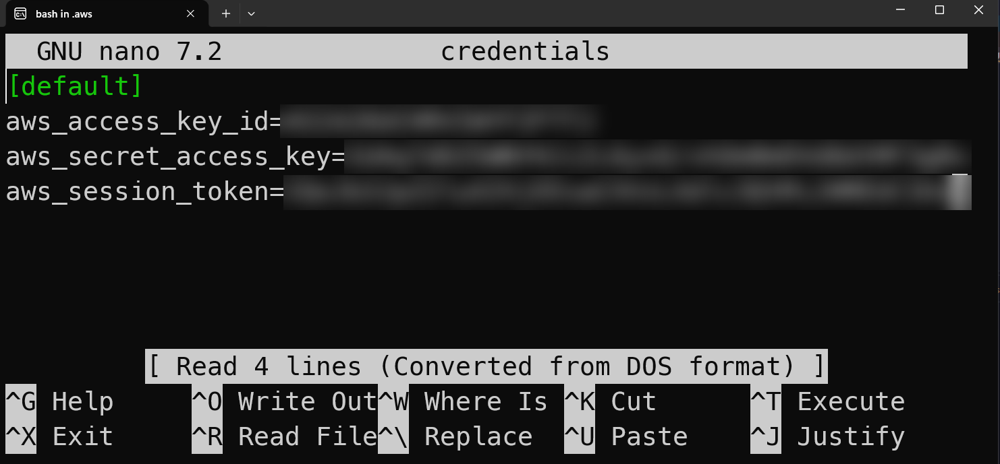

# Open Food Facts analytics

**Jorge Andrés Vargas Cordoba** · MUCSI, Universidad de Deusto (2026-27) · Big Data

Preguntas analíticas con Spark sobre el CSV de Open Food Facts (≈ 4,9 M productos, 13 GB), en un clúster Hadoop en AWS Academy (Ansible de clase + nuestros scripts).

## Arquitectura

| Nodo | Procesos | Qué hace |
|---|---|---|
| `hadoop-master` | NameNode, ResourceManager | Coordina HDFS y YARN. No ejecuta trabajos |
| `hadoop-worker-1/2/3` | DataNode, NodeManager | Guardan los bloques (3 réplicas) y ejecutan los executors de Spark (6 GB cada uno) |
| `hadoop-client-ingest` | driver de Spark | Sube el CSV a HDFS y lanza la limpieza. Usuario de HDFS `ingest` |
| `hadoop-client-query` | driver de Spark | Lanza las preguntas y dibuja las gráficas. Usuario de HDFS `query` |

| Ruta en HDFS | Dueño | Contenido |
|---|---|---|
| `/data/raw` | ingest | `openfoodfacts.csv` y `sample.csv` (2 %) |
| `/data/clean/products` | ingest | Parquet limpio |
| `/results/qNN-…` | query | Un CSV por pregunta |

`query` puede leer `/data` pero no escribir en ella (permisos 755). No lanzar a la vez trabajos de los dos clientes: comparten los 18 GB de YARN.

## Archivos

```
up.sh                 tu equipo: levanta todo (crea, enciende, configura y sube los datos)
down.sh               tu equipo: borra todo (o --stop para solo apagar)
nodes.sh              tu equipo: lista los nodos y el SSH de cada uno
tunnels.sh            tu equipo: abre las webs de HDFS y YARN en localhost (stop para cerrarlas)
run.sh                cliente: lanza un job de Spark en YARN
cluster/master.sh     master: setup (SSH, /etc/hosts, YARN, carpetas de HDFS, clientes) | check
cluster/client.sh     cliente: instala Java, Hadoop y Spark y fija su usuario de HDFS
cluster/worker-yarn-site.xml   YARN de los workers: 6 GB por nodo
ingest/load.sh        cliente ingest: descarga el CSV y lo sube a HDFS
ingest/clean.py       cliente ingest: CSV → Parquet limpio
query/q05…q08.py      cliente query: una pregunta por archivo
query/plots.py        cliente query: gráficas de las preguntas
```

## Preparar tu equipo

- Windows: **WSL** (Ubuntu) con `sudo apt install -y git python3-venv libffi-dev unzip` y [AWS CLI](https://docs.aws.amazon.com/cli/latest/userguide/getting-started-install.html).
- Una vez: `mkdir -p ~/.ssh ~/.aws && cp ~/Downloads/labsuser.pem ~/.ssh/vockey.pem && chmod 600 ~/.ssh/vockey.pem` (el PEM sale de AWS Details, Download PEM).
- En cada sesión: Learner Lab, **Start Lab**, AWS Details, AWS CLI, **Show**, y pegarlo en `~/.aws/credentials` (cambia cada vez).

  
  
  

- Si un script da `Permission denied`: `chmod +x *.sh cluster/*.sh ingest/*.sh`.

## Levantar y apagar

```bash
./up.sh              # la primera vez ~1 h; después, unos minutos
./down.sh --stop     # al acabar la sesión: apaga, HDFS conserva los datos
./down.sh            # al acabar el trabajo: borra las 6 instancias
```

`up.sh` se puede relanzar: crea lo que falta, enciende lo apagado y se salta lo hecho. Hace, en orden:

1. Ansible de clase (`memaldi/hadoop-ansible-ec2`): master y 3 workers con HDFS y YARN. Solo si no hay master (formatea HDFS).
2. Los dos clientes, con la misma AMI que el master.
3. `cluster/master.sh setup` en el master. Termina con dos SparkPi (uno por cliente) y el `check`.
4. `ingest/load.sh` en el cliente ingest: el CSV a HDFS (~15 min).

Al final imprime el `ssh` del master y los túneles de las webs de HDFS (50070) y YARN (8088).

Si va bien, tras `== 2. Master y workers` salen las tareas de Ansible (15–40 min). No interrumpirlo:


Cuando Ansible termina, en EC2 hay 4 instancias `running` (master y 3 workers) con los 3 *status checks* en verde:


> [!NOTE]
> La primera vez, Ansible tarda ≈ 15-20 min, casi todo en `Download Hadoop` (archive.apache.org limita la velocidad). Es una sola vez: con `./down.sh --stop` y `./up.sh` los nodos se reutilizan y no se descarga nada. No interrumpas Ansible a mitad.

## Conectarse y ver las webs

```bash
./nodes.sh           # nodos encendidos, su IP privada y el comando SSH de cada uno
./tunnels.sh         # HDFS y YARN en http://localhost:<puerto> (./tunnels.sh stop los cierra)
```

- El DNS del master cambia en cada arranque: `nodes.sh` siempre da el actual.
- Los workers no tienen SSH desde fuera: se entra desde el master (`ssh hadoop-worker-1`).
- Los clientes se pueden abrir directo con el comando de `nodes.sh`, o desde el master con `ssh hadoop-client-ingest` / `ssh hadoop-client-query`.

## Limpieza (cliente ingest)

Desde el master: `ssh hadoop-client-ingest`.

```bash
cd open-food-facts-analytics
./run.sh ingest/clean.py hdfs:///data/raw/sample.csv   # prueba con la muestra (~1 min)
./run.sh ingest/clean.py                               # CSV completo
```

Imprime las filas leídas, los productos limpios, los incoherentes y cuántos productos tienen cada dato.

## Preguntas (cliente query)

Desde el master: `ssh hadoop-client-query`.

```bash
cd open-food-facts-analytics
for f in query/q0*.py; do ./run.sh "$f"; done
hdfs dfs -get -f /results ./results && python3 query/plots.py   # PNG en figures/
```

| # | Pregunta | Técnica Spark |
|---|---|---|
| 5 | Las 5 marcas con la media más baja y más alta de azúcar, grasa saturada y sal, en cada grupo PNNS | `explode` + `groupBy` + `Window` con `row_number` |
| 6 | Productos añadidos por año, % con energía y macronutrientes y crecimiento anual | `groupBy` + `Window` con `lag` |
| 7 | % de productos con la energía declarada a más del 20 % de la calculada (4·carb. + 4·prot. + 9·grasa), por país | columna calculada + `explode` + `groupBy` |
| 8 | % que cumple «fuente de» y «alto contenido de» proteínas y fibra (Reglamento UE 1924/2006), por grupo PNNS | `when` por umbral + `groupBy` |

## Comprobar el clúster

En el master: `./open-food-facts-analytics/cluster/master.sh check` → procesos de cada nodo, `Live datanodes (3)`, `Total Nodes:3`, dueños de `/data` y `/results` y `Permission denied` cuando `query` intenta escribir en `/data`.

Logs: los de cada job en `logs/` del cliente; los de los executors, `yarn logs -applicationId <id>`.

## Comandos útiles

En un **cliente** (actúas como `ingest` o `query`) salvo donde dice *master* (allí eres `ec2-user`, el superusuario de HDFS).

| Para… | Comando |
|---|---|
| Ver carpetas y tamaños | `hdfs dfs -ls /data` · `hdfs dfs -du -h /data` · `hdfs dfs -df -h` |
| Mirar un resultado | `hdfs dfs -cat /results/q05-*/part-*.csv \| head` |
| Bajar un resultado a un archivo | `hdfs dfs -getmerge /results/q05-* q05.csv` |
| Borrar (solo tu carpeta) | `hdfs dfs -rm -r /results/q05-*` |
| Estado de HDFS, *master* | `hdfs dfsadmin -report \| head -20` (`Live datanodes (3)`) |
| Salud de los bloques, *master* | `hdfs fsck /data \| tail -15` |
| Nodos de YARN | `yarn node -list` |
| Jobs en ejecución / todos | `yarn application -list` · `yarn application -list -appStates ALL` |
| Logs de un job (executors) | `yarn logs -applicationId <id> \| less` |
| Matar un job | `yarn application -kill <id>` |
| Lanzar un job de Spark | `./run.sh query/q05-brands-by-pnns-group.py` (log en `logs/`) |
| Procesos Java de un nodo | `jps` (master: NameNode, ResourceManager; worker: DataNode, NodeManager) |
| Reiniciar un servicio, en el nodo | `sudo systemctl restart nodemanager` (también `datanode`, `namenode`, `resourcemanager`) |
| Qué usuario soy en HDFS | `echo $HADOOP_USER_NAME` |
| Instancias desde tu equipo | `aws ec2 describe-instances --filters "Name=tag:Name,Values=hadoop-*" --query "Reservations[].Instances[].[Tags[0].Value,State.Name]" --output text` |
